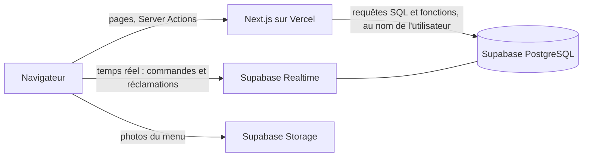
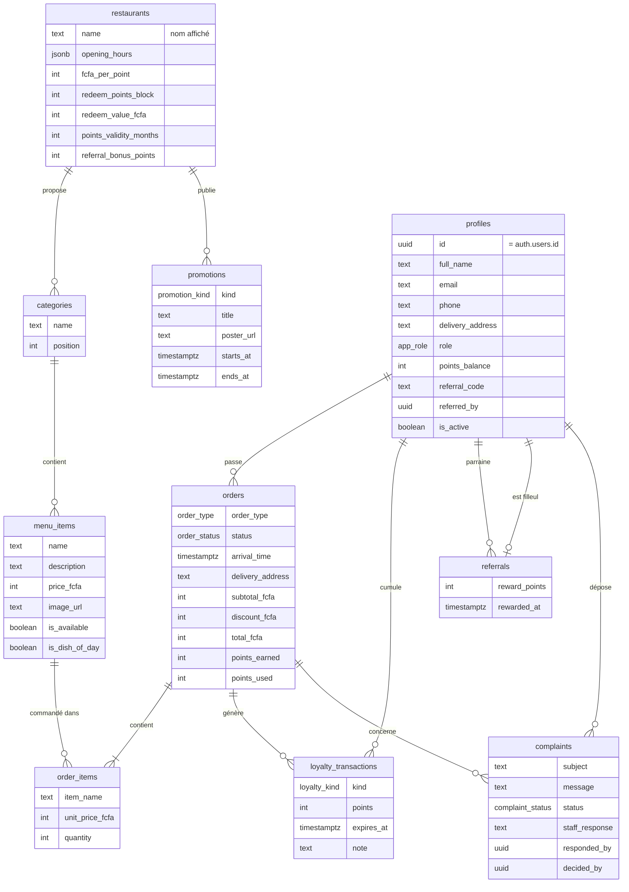

# Mon Miam Miam

Application web de commande et de fidélité du restaurant **ZeDuc@Space** : commande sur place ou en livraison, suivi en temps réel, points de fidélité, parrainage, et back-office pour les employés, le gérant et l'administrateur.

## Stack

| Couche | Outil |
| --- | --- |
| Application (front + back) | Next.js 16 (App Router, Server Actions, Cache Components), TypeScript |
| Interface | Tailwind CSS 4, polices Anton et Archivo |
| Base de données, auth, temps réel | Supabase (PostgreSQL 17, Auth, Realtime) |
| Tests | Vitest (unitaires), Playwright (bout en bout) |
| CI | GitHub Actions |

## Démarrer en local

Prérequis : Node.js 22 et Docker (pour Supabase local).

```bash
npm install
npm run db:start            # lance Supabase local, applique les migrations et les données de démo
npx supabase status -o env  # affiche API_URL et PUBLISHABLE_KEY
cp .env.example .env.local  # puis colle API_URL et PUBLISHABLE_KEY
npm run dev                 # http://localhost:3000
```

Comptes de démo (mot de passe `MiamMiam2026`) :

| Rôle | Email | Espace |
| --- | --- | --- |
| Étudiant | etudiant@miammiam.test | /espace |
| Employé | employe@miammiam.test | /employe |
| Gérant | gerant@miammiam.test | /gerant |
| Gérant de ZeDuc@Campus (2e restaurant) | gerant.campus@miammiam.test | /gerant |
| Administrateur | admin@miammiam.test | /admin |

Les emails envoyés en local (confirmation, mot de passe oublié) sont visibles sur http://127.0.0.1:54324.

## Scripts

| Commande | Rôle |
| --- | --- |
| `npm run dev` | Serveur de développement |
| `npm run lint` / `npm run typecheck` | Qualité du code |
| `npm test` | Tests unitaires |
| `npm run test:e2e` | Tests de bout en bout (Supabase local et application lancés) ; `PW_ALL_BROWSERS=1` ajoute Safari et Firefox |
| `npm run db:reset` | Recrée la base locale depuis les migrations et `supabase/seed.sql` |
| `npm run db:types` | Régénère les types TypeScript de la base |

## Architecture

Une seule application Next.js, déployée sur Vercel, qui parle à Supabase :



- **Lecture** : les pages serveur lisent la base avec la session de l'utilisateur ; la Row Level Security décide de ce que chacun voit. Chaque chargement de données est entouré d'un squelette (`<Suspense>`).
- **Écriture** : les formulaires appellent des Server Actions, qui valident les champs (Zod) puis appellent la base. Tout ce qui touche à l'argent ou aux points passe par une fonction SQL transactionnelle.
- **Temps réel** : l'écran cuisine et le suivi étudiant s'abonnent aux changements de `orders` et `complaints`, puis rechargent la page (avec un rechargement de secours toutes les 15 secondes).
- **Rôles** : `etudiant`, `employe`, `gerant`, `admin`. `src/proxy.ts` renvoie vers la connexion, chaque page revérifie le rôle côté serveur, et la base l'impose une troisième fois.

## Schéma de la base



- `profiles.points_balance` est toujours la somme de `loyalty_transactions` : seules les fonctions SQL l'écrivent.
- `order_items` garde le nom et le prix au moment de la commande : changer le menu ne modifie pas l'historique.
- Statuts d'une commande : `en_attente` → `en_preparation` → `prete` → (`en_livraison`) → `livree`, ou `annulee`.

## Structure

```
src/app/                  pages (accueil, (auth), (legal), espace, employe, gerant, admin)
src/components/           composants d'interface et de chargement
src/features/             par domaine : menu, personnel, paramètres, commandes, panier, réclamations, statistiques, espace étudiant
src/lib/orders/           règles pures testées : panier, points, statuts, heures
src/lib/auth/             rôles, validation des formulaires, accès aux données
src/lib/supabase/         clients Supabase (navigateur, serveur, proxy) et types
src/proxy.ts              rafraîchit la session et protège les espaces
supabase/migrations/      schéma SQL versionné
supabase/seed.sql         données de démonstration
e2e/                      tests Playwright
```

## Sécurité des données

- Chaque table a la Row Level Security activée. Un étudiant ne voit que ses commandes, ses points et ses réclamations ; le personnel voit tout.
- Le rôle d'un compte n'est jamais lu depuis les données envoyées par le navigateur. Un utilisateur ne peut modifier que son nom, son téléphone et son adresse.
- Un employé ne peut changer que la disponibilité d'un plat et le plat du jour : un déclencheur SQL refuse toute autre modification, même en appelant l'API directement.
- Le personnel se gère par des fonctions SQL qui vérifient le rôle : le gérant ne gère que les employés, l'admin gère tout le monde, et personne ne modifie son propre compte.
- Les photos du menu vont dans le bucket public `menu-photos` (3 Mo, JPEG, PNG ou WebP) ; seuls le gérant et l'admin peuvent y écrire.
- Commandes, points et parrainages ne s'écrivent que par des fonctions SQL transactionnelles, pour qu'un client ne puisse fixer ni ses prix ni ses points :
  - `place_order` relit les prix en base, vérifie le solde de points et l'heure d'arrivée, et limite à 3 commandes en cours ;
  - `advance_order` (personnel) suit l'ordre en attente → en préparation → prête → (en livraison) → livrée ; à la livraison il crédite les points, et le bonus du parrain à la première commande du filleul ;
  - `cancel_my_order` (client, tant que la commande est en attente) et l'annulation côté cuisine rendent les points utilisés ;
  - `respond_complaint` et `decide_complaint` : l'employé propose une réponse, le gérant la valide (avec un geste en points s'il le souhaite), la renvoie ou rejette la réclamation ;
  - `get_stats` réserve les statistiques au personnel ;
  - `comment_my_order` laisse le client donner son avis sur sa propre commande, une fois servie ;
  - `top_customers` calcule le top 10 du jour, de la semaine ou du mois (prénom et initiale pour les étudiants, nom complet pour le personnel) ;
  - notifications : chaque appareil s'abonne avec `save_push_subscription` (table `push_subscriptions`, visible seulement par son propriétaire). Après un changement de statut, le serveur lit les appareils du client avec `order_push_targets`, réservé au personnel et seulement dans les deux minutes qui suivent ce changement, puis envoie la notification (bibliothèque `web-push`, clé privée VAPID côté serveur uniquement) ;
  - `play_quiz` et `spin_wheel` (étudiants seulement) : une partie par jeu et par jour, tirage de la roue fait en base, points crédités avec la même validité que les autres ; `my_games_today` ne révèle la bonne réponse qu'après avoir joué, et la table des questions n'est lisible que par le gérant et l'admin ;
  - les points expirent après la durée réglée dans les paramètres : une tâche `pg_cron` (`expirer-points-fidelite`, chaque heure) retire les points échus, en consommant toujours d'abord ceux qui expirent le plus tôt ; `my_next_points_expiry` annonce la prochaine échéance au client.

## Mise en ligne

1. **Supabase** : créer un projet sur supabase.com, puis :
   ```bash
   npx supabase login
   npx supabase link --project-ref <ref-du-projet>
   npx supabase db push            # applique les migrations
   ```
   La migration `20261024180000_deuxieme_version.sql` active l'extension `pg_cron` (disponible sur tous les projets Supabase).
   À refaire après chaque fusion qui ajoute un fichier dans `supabase/migrations/` : Vercel déploie le code mais n'applique pas les migrations.
   Dans Authentication > URL Configuration, renseigner l'URL du site et ajouter `https://<domaine>/**` aux redirections autorisées. Dans Authentication > Providers > Email, exiger 8 caractères avec minuscules, majuscules et chiffres.
2. **Vercel** : importer le dépôt GitHub, puis définir `NEXT_PUBLIC_SUPABASE_URL`, `NEXT_PUBLIC_SUPABASE_PUBLISHABLE_KEY` et `NEXT_PUBLIC_SITE_URL`. Chaque push sur `main` est alors déployé.
3. **Notifications** : générer une paire de clés avec `npx web-push generate-vapid-keys`, puis ajouter dans Vercel `NEXT_PUBLIC_VAPID_PUBLIC_KEY` (clé publique), `VAPID_PRIVATE_KEY` (clé privée, à garder secrète) et `VAPID_SUBJECT` (`mailto:` + email de contact), et redéployer. Sans ces clés, le site marche normalement mais sans notifications.

## Fonctionnalités

- **Étudiant** (`/espace`) : menu et panier, commande sur place (heure d'arrivée) ou en livraison (adresse), réduction avec les points, suivi en direct, historique, annulation tant que la cuisine n'a pas commencé, fidélité (solde, historique, filleuls, partage du code), réclamations.
- **Employé** (`/employe`) : écran cuisine en temps réel, réclamations (réponse proposée au gérant), statistiques de la semaine.
- **Gérant et admin** : supervision des commandes, validation des réclamations, statistiques par jour, semaine ou mois.
- **Deuxième version** : affiches de promotions et d'événements publiées par le gérant ou l'admin (`/gerant/promotions`) et visibles sur l'accueil étudiant, top 10 des clients (`/espace/classement` et statistiques), avis après une commande servie, expiration des points avec rappel de la prochaine échéance.
- **Mini-jeux** (`/espace/jeux`) : un quiz du jour et une roue de la chance, une partie de chaque par jour, pour gagner des points. Le gérant et l'admin gèrent les questions (`/gerant/jeux`), ouvrent ou ferment les jeux et règlent les points du quiz dans les paramètres.
- **Application installable** : le site s'installe sur l'écran d'accueil (Android, iPhone, ordinateur), s'ouvre sur l'espace étudiant et affiche une page « Pas de connexion » hors réseau. L'étudiant peut activer les notifications : il est prévenu quand sa commande est acceptée, prête, en livraison ou annulée. Sur iPhone, il faut d'abord installer l'application (iOS 16.4 ou plus récent).
- **Tout le monde** : bandeau cookies (seulement des cookies nécessaires), mentions légales et politique de confidentialité. Les coordonnées légales se règlent dans `src/lib/legal.ts`.
- **Paiement** : sur place ou à la livraison ; aucun paiement en ligne pour l'instant (CinetPay prévu plus tard).

Règles de fidélité (modifiables dans les paramètres) : 1 point par tranche de 1 000 F, 15 points = 1 000 F de réduction, 5 points au parrain après la première commande servie du filleul.

## Avancement

- [x] Étape 1 : fondations (projet, schéma, authentification, rôles, CI)
- [x] Étape 2 : back-office (menu, employés, paramètres)
- [x] Étape 3 : commande, cuisine en temps réel, fidélité, parrainage, réclamations, statistiques
- [x] Étape 4 : qualité et mise en ligne (cookies, pages légales, espace étudiant sur ordinateur, tests sur Chrome, Firefox et Safari)
- [x] Étape 5 : deuxième version (affiches de promotions et d'événements, top 10 des clients, expiration des points, avis après commande)
- [x] Plus tard (1) : mini-jeux (quiz du jour, roue de la chance)
- [x] Plus tard (2) : application installable et notifications de commande
